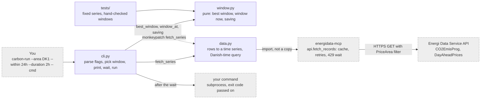

# Architecture

Arrows read "uses". The dashed arrow is a test-only swap. Line numbers point at the main function of each box.

| Box | File | Main function | What it does |
|---|---|---|---|
| cli.py | `src/carbon_aware_runner/cli.py:83` | `main` (also `plan` at :41, `report` at :64) | Reads the flags, asks for data from now to the deadline, picks the window, prints it, sleeps until it starts and runs the command. `--dry-run` stops after printing. |
| window.py | `src/carbon_aware_runner/window.py:64` | `best_window` (also `window_at` at :51, `saving` at :89) | No network and no clock: lowest-mean run of back-to-back slots that starts no earlier than the slot holding "now" and ends by the deadline. Ties go to the earliest start. |
| data.py | `src/carbon_aware_runner/data.py:38` | `fetch_series` (also `to_series` at :25) | Turns the UTC window into the Danish local times the API expects and the rows into (UTC time, value) pairs. |
| energidata-mcp | dependency, `energidata_mcp/api.py` | `fetch_records` | The HTTP client from [energidata-mcp](https://github.com/batutho-dot/energidata-mcp), installed as a package. |

## Choices

- **Forecast, not realised data.** `CO2EmisProg` is Energinet's forecast in 5-minute steps; on 2026-11-19 at 22:40 it reached the end of the next day. `CO2Emis` (realised) stops at the present, so it cannot rank future hours. If `--within` reaches past the forecast, the tool says so and only looks at the covered part.
- **Native step.** Windows are built on the dataset's own step (5 min for CO2, 15 min for prices), and the duration is rounded up to whole steps.
- **Saving is per unit of energy.** The tool does not know how much power the job draws, so it reports the difference in mean intensity (g CO2/kWh) or price (DKK or EUR/MWh) and the percentage. Multiply by the job's energy use for an absolute figure.
